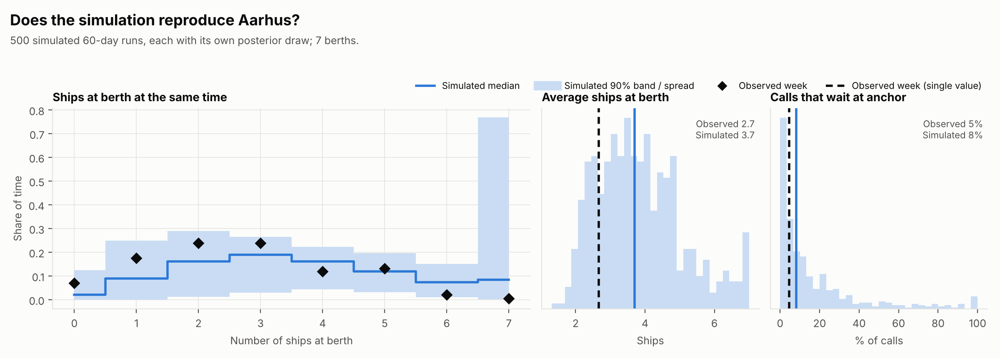
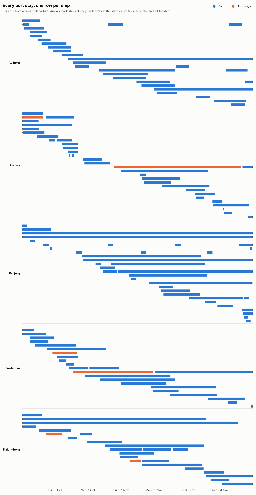
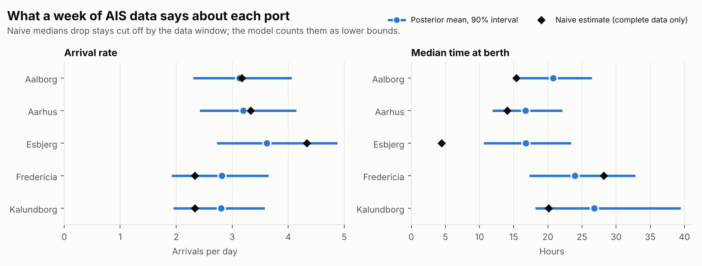

# Port Congestion Simulation from Danish AIS Data

A discrete-event simulation of port congestion, calibrated with Bayesian inference on one week of real ship-tracking data from five Danish ports.



*500 simulated 60-day runs of the port of Aarhus, each with its own parameter set drawn from the posterior distribution. The black markers are what really happened during the observed week.*

The pipeline goes from 23 GB of raw ship-position reports to a calibrated SimPy model in four steps:

1. Turn position reports into port calls.
2. Explore the data visually.
3. Fit a hierarchical Bayesian model of arrivals and time at berth.
4. Simulate the port with uncertainty carried through from the data.


---

## The data

The data is AIS (Automatic Identification System) data published by the [Danish Maritime Authority](https://admin.dma.dk/safety-at-sea/navigational-information/download-data). Ships broadcast their position, speed and status every few seconds. One day covers about 3.3 GB and 18 million reports.

| | |
|---|---|
| Period | 29 Oct – 4 Nov 2026 (7 days) |
| Raw data | 7 daily CSV files, about 23 GB in total (not in this repository) |
| Ports | Aalborg, Aarhus, Esbjerg, Fredericia, Kalundborg |
| After cleaning | 273,313 reports from 124 cargo and tanker ships of 80 m or longer |
| Port calls | 128 calls, of which 32 are cut off by the start or end of the week |
| Waits at anchor | 4 calls waited at anchor before berthing (8–92 hours) |

Copenhagen and Skagen were screened and left out. At Copenhagen most of the traffic is passing through the Øresund strait. At Skagen the ships at anchor are mostly refuelling or waiting for orders rather than queuing for a berth.

---

## Pipeline

```
raw AIS (3.3 GB/day)
   │  scripts/inspect_day.py   slice each day to the port areas (about 2 MB/day kept)
   ▼
data/inspect/<day>/slices/
   │  src/stays.py             clean, join the days, detect stays at berth and at anchor
   ▼
data/stays.csv
   │  src/viz.py               exploratory figures 01–04
   │  src/calibrate.py         hierarchical Bayesian model (PyMC), figures 05–06
   ▼
data/posterior_draws.csv
   │  src/simulate.py          SimPy model driven by the posterior, figure 07
   ▼
data/sim_baseline.csv
```

### 1. From position reports to port calls (`stays.py`)

Most of the work is here, because raw AIS data is messy:

- **Duplicates:** the same message is often received by several shore stations, so reports are de-duplicated by ship and timestamp.
- **Small vessels:** tugs, bunkering barges and harbour craft are removed by keeping only Class A transponders on ships of 80 m or longer.
- **Bad values:** placeholder positions (91° latitude) and reports with no speed are dropped.
- **Navigational status can't be trusted:** ships that sat still for 10–15 hours reported "Moored" only 15–50% of the time. Stays are therefore detected from **speed and position** (stationary means below 0.5 knots).
- **Signal gaps:** a stay ends if a ship goes silent for more than 30 minutes. Stays split by a short drift in the same place are rejoined.
- **Days joined together:** the days are processed as one week, so a stay that runs past midnight counts once.

A stay counts as *anchorage* if the ship mostly reports "At anchor", and as *berth* otherwise. Stays of the same ship less than 6 hours apart are grouped into one port call, so that wait at anchor followed by time at berth is one call.

### 2. Exploring the data (`viz.py`)



Every stay over the week, one row per ship. Orange bars followed by blue bars are ships that waited at anchor before going to a berth.

| Figure | What it shows |
|---|---|
| `01_port_maps.png` | Ship tracks and stays: berths and anchorages show up in the data without any hand-drawn areas |
| `02_stay_timeline.png` | Every stay over the week |
| `03_occupancy.png` | How many ships were at berth or at anchor every 15 minutes, for each port |
| `04_berth_durations.png` | Time at berth; hollow points are stays cut off by the start or end of the week |

### 3. Bayesian calibration (`calibrate.py`)

The model is hierarchical: each port has its own parameters, but they're pulled towards a shared average, so ports with few calls borrow strength from the others.

**Arrivals:** the number of arrivals per day at port *p*

```
arrivals_p,day ~ Poisson(λ_p)
log λ_p ~ Normal(μ_λ, σ_λ)
```

**Time at berth:** lognormal, with ship length as a predictor and a separate spread for each port

```
log(hours) ~ Normal(α_p + β · z(log length), σ_p)
α_p ~ Normal(μ_α, τ_α),   log σ_p ~ Normal(μ_σ, τ_σ)
```

**Censoring.** 32 of the 128 calls are cut off by the start or end of the data window, so their observed time is a lower bound on the real stay. These calls enter the likelihood through the survival function (`pm.Censored`) instead of being dropped or taken at face value. Dropping them would bias berth times downwards.

Sampling uses NUTS: 4 chains of 1,000 draws, with no divergences and R-hat of 1.00.



| Port | Arrivals per day (90% interval) | Median time at berth (90% interval) | Most ships at berth at once |
|---|---|---|---|
| Aalborg | 3.1 (2.3–4.1) | 21 h (16–26) | 6 |
| Aarhus | 3.2 (2.4–4.1) | 17 h (12–22) | 7 |
| Esbjerg | 3.6 (2.7–4.9) | 17 h (11–23) | 11 |
| Fredericia | 2.8 (1.9–3.7) | 24 h (17–33) | 6 |
| Kalundborg | 2.8 (2.0–3.6) | 27 h (18–39) | 7 |

Ship length turned out to have no clear effect on time at berth (β = 0.10, 90% interval −0.08 to 0.28). Posterior predictive checks are in `figures/06_ppc.png`.

### 4. Discrete-event simulation (`simulate.py`)

The SimPy model of one port (Aarhus by default) works like this:

- **Ships arrive** as a Poisson process at rate λ.
- **Ship length** is resampled from the lengths observed at that port.
- **Time at berth** is drawn from the fitted lognormal model.
- **Berths** are a SimPy `Resource` with a capacity of 7, the most ships seen at berth at once at Aarhus.
- **No free berth:** the ship waits at anchor, first come, first served.

Each replication draws **one parameter set from the posterior**, so the 500 runs carry parameter uncertainty as well as day-to-day randomness. Each run lasts 60 days after a 10-day warm-up, and all 500 take about 4 seconds.

| Aarhus | Observed week | Simulated median |
|---|---|---|
| Average ships at berth | 2.7 | 3.7 |
| Share of calls that wait at anchor | 5% | 8% |
| Ships at berth at the same time | every count from 0 to 7 is inside the simulated 90% band | |

---

## What the results show, and what they don't

**What they show**

- A complete, reproducible pipeline from raw AIS data to a calibrated simulation, with uncertainty carried through every step.
- The simulation reproduces the week it was calibrated on. Every observed value falls inside the simulated range.
- Correct handling of censored stays changes the estimates materially, compared with simply averaging complete stays.


- **This is a consistency check, not a test of predictions.** The model is compared with the same week used to fit it. 


## Next steps

1. **Disruption scenarios:** berths closed for a week, port closures from storms, and demand surges, using SimPy's `PreemptiveResource` and a weather process. The outputs would be over time: peak queue, ship-hours of waiting, waiting cost and recovery time.
2. **Prediction test:** fit on this week and predict the next one.
3. **More data:** add more weeks and show the posterior uncertainty shrinking as data accumulates.
4. **Berth constraints:** some berths only serve certain ships (for example tankers at the oil berth), and priority rules.

---

## Running it

```bash
pip install -r requirements.txt
```

1. Download daily AIS files from the [DMA](https://admin.dma.dk/safety-at-sea/navigational-information/download-data) and put the unzipped `aisdk-YYYY-MM-DD.csv` files in `data/`. Keep them outside cloud-synced folders if you can, since each is about 3 GB.
2. Run the pipeline:

```bash
python scripts/inspect_day.py   # slices every day file in data/ (about 5 min per day)
python src/stays.py
python src/viz.py
python src/calibrate.py
python src/simulate.py          # set PORT at the top of the file to simulate another port
```

Raw and derived data are not committed (see `.gitignore`). Everything in `data/` is regenerated by the scripts above.

## Repository layout

```
scripts/inspect_day.py   slice raw daily AIS files to candidate port areas
scripts/fetch_ais_day.py optional: download and slice a single day
src/stays.py             cleaning and stay detection
src/viz.py               exploratory figures
src/calibrate.py         hierarchical Bayesian model (PyMC)
src/simulate.py          SimPy port model and validation
figures/                 all figures (01–07)
```

## Tools

Python · pandas · PyMC · SimPy · matplotlib

Data: AIS data from the Danish Maritime Authority, used under the authority's terms for AIS data.
